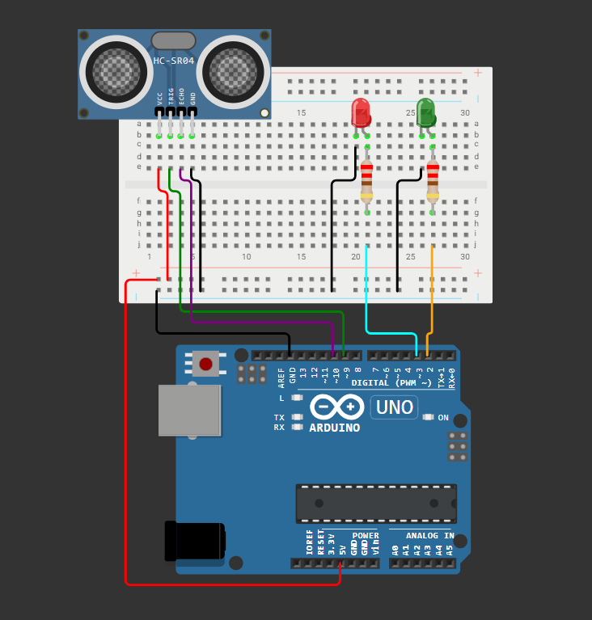

# IoT MedTech Distance Alert System 🩺📏

Professional-grade, containerized IoT MedTech Telemetry API with automated BDD testing and CI/CD orchestration.

---

## 🛠️ Hardware-Aufbau & Verkabelung

Das nachfolgende Anschlussdiagramm zeigt den Aufbau des MedTech-Prototypen zur Distanzüberwachung:



### Komponenten:
- **Mikrocontroller:** Arduino Uno (oder kompatibles Board)
- **Sensor:** HC-SR04 Ultraschallsensor (Distanzmessung)
- **Signalisierung:** Rote LED & Grüne LED (mit Vorwiderständen)
- **Steckplatine & Jumper Wire**

### Pin-Belegung:
| Komponente | Sensor / Bauteil Pin | Arduino Pin | Funktion |
| :--- | :--- | :--- | :--- |
| **HC-SR04 Sensor** | VCC | `5V` | Stromversorgung |
| | TRIG | Digital Pin | Trigger-Signal (Impulsstart) |
| | ECHO | Digital Pin | Echo-Signal (Rücklaufmessung) |
| | GND | `GND` | Masse |
| **LEDs & Widerstände** | Rote LED (Warnung) | Digital Pin (PWM) | Warn-Signal bei unzulässiger Nähe |
| | Grüne LED (Status) | Digital Pin (PWM) | Normalzustand / Betriebsanzeige |

---

## 🏗️ Architecture Overview

- **Backend API:** FastAPI (Python 3.10+)
- **Hardware Abstraction Layer (HAL):** Supports physical `HARDWARE` serial inputs and automated `MOCK` telemetry mode[cite: 26].
- **Test Automation:** Behavior-Driven Development (BDD) via Behave (Gherkin syntax) & Pytest.
- **Orchestration:** Docker & Docker Compose.
- **CI/CD:** GitHub Actions automated test runner.

---

## 🚀 Running Locally with Docker Compose

```bash
docker compose up --build --exit-code-from bdd-test-runner
```
---
## 📁 Project Structure

```text
iot-medtech-distance-alert/
├── 📂 .github/
│   └── 📂 workflows/             # GitHub Actions CI/CD pipeline definition
├── 📂 features/                  # Gherkin feature files & Behave step definitions
├── 📂 firmware/                  # Embedded Arduino/C++ sensor logic
├── 🖼️ hardware_schema.png         # Hardware-Schaltplan (Arduino Uno & HC-SR04)
├── 📄 Dockerfile                 # Multi-stage container build definition
├── 📄 docker-compose.yml         # Multi-container service orchestration
├── 📄 main.py                    # FastAPI application entry point
├── 📄 requirements.txt           # Python dependencies
└── 📄 sensor_reader.py           # HAL layer for serial telemetry & mocking
```