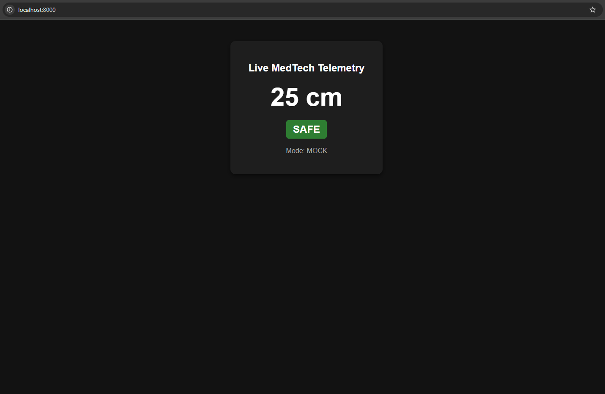

# IoT MedTech Distance Alert System 🩺📏

Professional-grade, containerized IoT MedTech Telemetry API with automated BDD testing and CI/CD orchestration.

---

## 🛠️ Hardware Setup & Wiring

The following circuit diagram shows the hardware configuration of the MedTech distance monitoring prototype:


### Components:
- **Microcontroller:** Arduino Uno 
- **Sensor:** HC-SR04 Ultrasonic Sensor (distance measurement)
- **Alert Signaling:** Red LED & Green LED (with current-limiting resistors)
- **Breadboard & Jumper Wires**

### Pinout Mapping:
| Component | Sensor / Component Pin | Arduino Pin | Function |
| :--- | :--- | :--- | :--- |
| **HC-SR04 Sensor** | VCC | `5V` | Power Supply |
| | TRIG | Digital Pin | Trigger Signal (pulse start) |
| | ECHO | Digital Pin | Echo Signal (travel time measurement) |
| | GND | `GND` | Ground |
| **LEDs & Resistors** | Red LED (Warning) | Digital Pin (PWM) | Alert signal for unsafe distance / proximity |
| | Green LED (Status) | Digital Pin (PWM) | Normal operation / status indicator |

---

## 🏗️ Architecture Overview

- **Backend API:** FastAPI (Python 3.10+) with WebSocket live streaming.
- **Hardware Abstraction Layer (HAL):** Supports physical `HARDWARE` serial inputs and automated `MOCK` telemetry mode.
- **Test Automation:** Behavior-Driven Development (BDD) via Behave (Gherkin syntax) & Pytest.
- **Orchestration:** Docker & Docker Compose.
- **CI/CD:** GitHub Actions automated test runner.

---

## 📊 Live Dashboard User Interface



---

## 🚀 Running Locally

### Option 1: Using Python & Uvicorn (Local Development)
```bash
# Create and activate virtual environment
python -m venv venv
source venv/Scripts/activate   # On Linux/macOS: source venv/bin/activate

# Install dependencies
pip install -r requirements.txt

# Start FastAPI server
uvicorn main:app --reload --host 0.0.0.0 --port 8000
```
#### Open browser at 👉 http://localhost:8000

---

### Option 2: Using Docker Compose
```bash
docker compose up --build --exit-code-from bdd-test-runner
```
How Docker Compose works in this project:
The docker-compose.yml file orchestrates a multi-container setup consisting of two synchronized services:

1. **medtech-api (medtech_distance_api):**

- Builds and runs the FastAPI backend container in mock telemetry mode (SERIAL_PORT=MOCK).

- Exposes port 8000 and features a built-in health check (/health) to ensure the server is fully responsive before dependent services start.

2. **bdd-test-runner (medtech_bdd_runner):**

- Automatically waits until the FastAPI API container passes its health check (condition: service_healthy).

- Executes the complete Behavior-Driven Development (BDD) test suite using Behave and Gherkin feature files against the running API container.

- The --exit-code-from bdd-test-runner flag ensures that the exit code of the test container is passed back to the host terminal (passing with 0 or failing if tests break) and automatically tears down all containers after execution.

---

## 📁 Project Structure
```test
iot-medtech-distance-alert/
├── 📂 .github/
│   └── 📂 workflows/             # GitHub Actions CI/CD pipeline definition
├── 📂 features/                  # Gherkin feature files & Behave step definitions
├── 📂 firmware/                  # Embedded Arduino/C++ sensor logic
├── 📂 venv/                      # Local Python virtual environment
├── 🖼️ hardware_schema.png         # Hardware circuit diagram (Arduino Uno & HC-SR04)
├── 🖼️ iot_medtech_distance_alert_dashboard.png  # Live telemetry dashboard screenshot
├── 📄 Dockerfile                 # Multi-stage container build definition
├── 📄 docker-compose.yml         # Multi-container service orchestration
├── 📄 main.py                    # FastAPI application entry point & WebSocket dashboard
├── 📄 requirements.txt           # Python dependencies
└── 📄 sensor_reader.py           # HAL layer for serial telemetry & mocking
```
